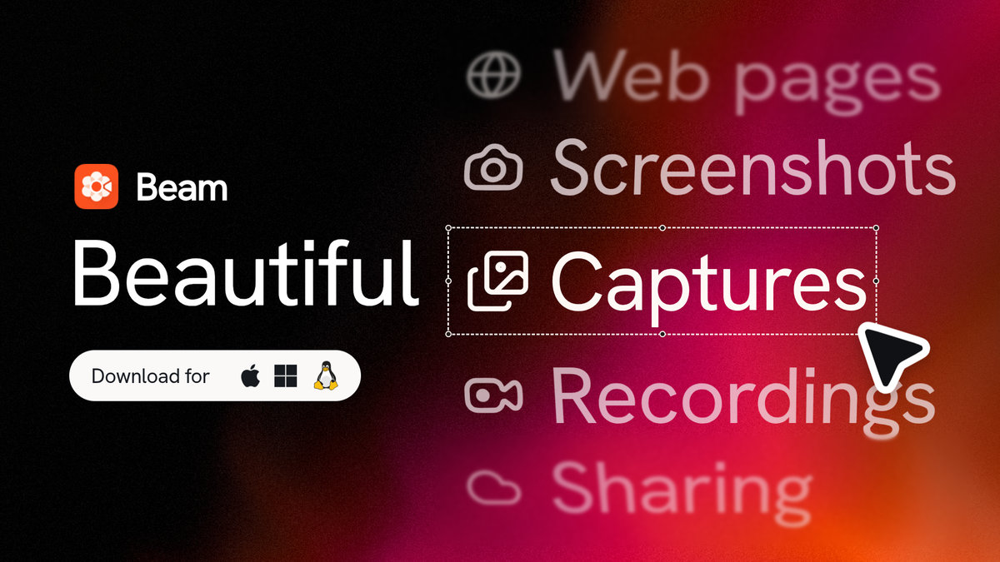
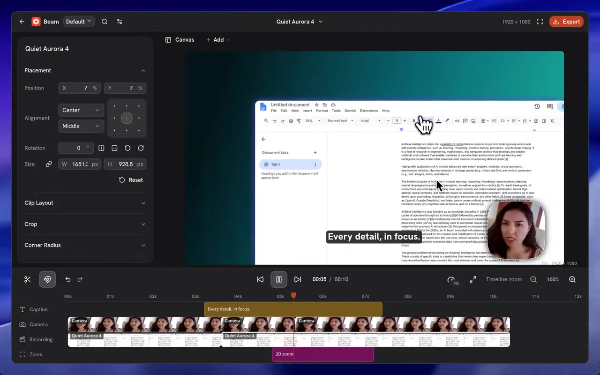
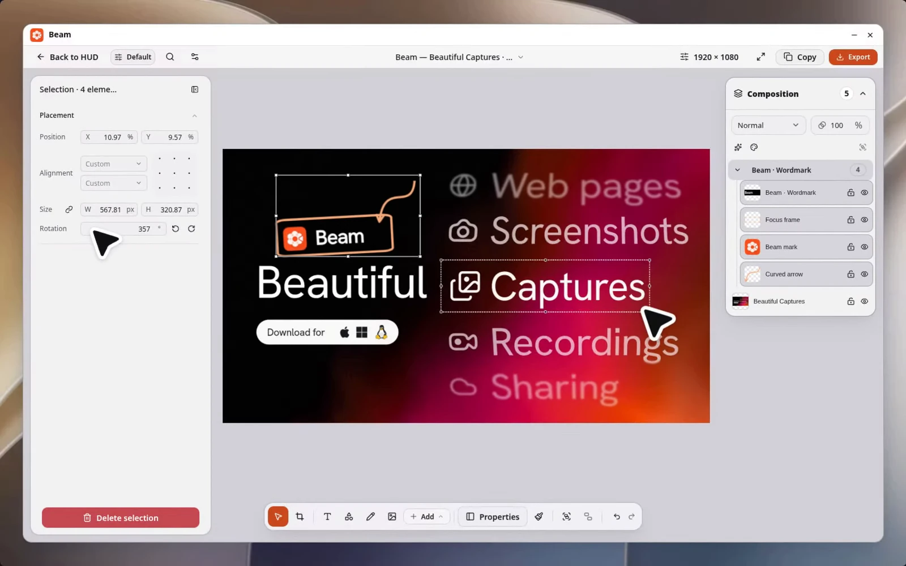

<h1 align="center">Beam</h1>

<p align="center"><strong>Beautiful recordings. Clear screenshots. Made on your desktop.</strong></p>

<p align="center">
  Record a walkthrough, polish a product demo, or make a screenshot explain itself.<br />
  Free, open-source, and available for Windows, macOS, and Linux.
</p>

<p align="center">
  <a href="https://beam.plinka.eu"><strong>Website</strong></a> ·
  <a href="https://beam.plinka.eu/docs">Documentation</a> ·
  <a href="https://github.com/BeamRecorder/Beam/releases/latest">Latest release</a> ·
  <a href="https://discord.gg/UZcr2sxYNA">Join Discord</a>
</p>

<p align="center">
  <a href="https://beam.plinka.eu/download?os=windows"><strong>Download for Windows</strong></a> ·
  <a href="https://beam.plinka.eu/download?os=macos"><strong>Download for macOS</strong></a> ·
  <a href="https://beam.plinka.eu/download?os=linux"><strong>Download for Linux</strong></a>
</p>

<a href="https://beam.plinka.eu">
  
</a>

## Get Beam

The website downloads the latest release for your chosen system. For a direct download, use the **0.5.6** installers below.

<!-- Keep versioned installer links aligned with the release when bumping Beam. -->

| System | Latest version | Direct · 0.5.6 |
| --- | --- | --- |
| Windows · x64 / ARM64 | [Download](https://beam.plinka.eu/download?os=windows) | [EXE](https://github.com/BeamRecorder/Beam/releases/download/0.5.6/Beam-Setup-0.5.6.exe) |
| macOS · Apple silicon | [Download](https://beam.plinka.eu/download?os=macos) | [DMG](https://github.com/BeamRecorder/Beam/releases/download/0.5.6/Beam-0.5.6-arm64.dmg) |
| Linux · x64 | [Download](https://beam.plinka.eu/download?os=linux) | [AppImage](https://github.com/BeamRecorder/Beam/releases/download/0.5.6/Beam-0.5.6-linux-x86_64.AppImage) · [DEB](https://github.com/BeamRecorder/Beam/releases/download/0.5.6/Beam-0.5.6-linux-amd64.deb) · [RPM](https://github.com/BeamRecorder/Beam/releases/download/0.5.6/Beam-0.5.6-linux-x86_64.rpm) |

[All releases](https://github.com/BeamRecorder/Beam/releases) · [What's new](./CHANGELOG.md) · [Installation and getting started](https://beam.plinka.eu/docs/getting-started)

The Windows installer includes both architectures. On Apple silicon Macs running macOS 13 or later, move Beam to Applications and grant Screen Recording, Camera, and Microphone permissions for the sources you enable. Linux recording needs a working ScreenCast portal, PipeWire, and FFmpeg; see the [Linux setup and compatibility guide](./docs/dev/linux.md).

## Three ways to capture

| Mode | Your workflow | Great for |
| --- | --- | --- |
| **Instant** | Choose a saved look, record, and stop. Beam renders locally and copies the finished video file to your clipboard. | Quick walkthroughs, bug reports, async updates |
| **Studio** | Record into an editable project. Shape the timing, camera, cursor, captions, and sound, then export. | Product demos, tutorials, launch videos |
| **Screenshot** | Capture a screen, window, or region. Crop, annotate, arrange layers, then copy or export the image. | Documentation, support, pull requests |

[Explore Instant](https://beam.plinka.eu/features/instant) · [Explore Studio](https://beam.plinka.eu/features/editing) · [Explore Screenshot](https://beam.plinka.eu/features/screenshots)

## Record. Shape. Make it yours.

<picture>
  <source media="(prefers-color-scheme: dark)" srcset="./docs/assets/readme/studio-dark.webp" />
  <source media="(prefers-color-scheme: light)" srcset="./docs/assets/readme/studio-light.webp" />
  
</picture>

- **Capture your setup.** Full screen, an application window, or a custom region, with webcam, microphone, and supported system audio. Keep a floating teleprompter nearby while you record.
- **Start when you're ready.** Begin with your saved countdown, or opt into a preparation bar to adjust devices and settings before pressing Record.
- **Guide the viewer.** Automatic zooms follow recorded actions. Refine the focus yourself, use a loupe, or choose a 3D camera preset with adjustable perspective and pullback.
- **Make the cursor feel right.** Smooth movement, cursor styles and sizing, click springs, 3D appearance, and motion blur use the same rendering path in preview and export.
- **Edit at your own pace.** Trim, split, rearrange, and layer clips on a multi-track timeline. Keep screen, webcam, microphone, and system audio editable as separate sources where supported.
- **Finish the look.** Backgrounds, gradients, blur, padding, rounded corners, shadows, borders, and reusable presets. Add text, shapes, drawings, highlights, and masks.
- **Caption locally.** Generate captions on your device with Whisper, then edit their wording, timing, and style.

## A screenshot that explains itself



Crop the source, point out a detail with an arrow, cover sensitive text with blur, and arrange images and annotations as editable layers. Group elements, change their order, and dock Composition in the title bar when you want more room.

Add a background and shadow, experiment with Dithering, ASCII, Grain, or Cyanotype, or use a 2D, 3D, or glass zoom. Copy the finished image or export **PNG / WebP**, including transparency when the background is disabled.

## Local projects. Finished files.

Screen capture, editing, Whisper captions, and rendering run on your computer. Keep your projects and media locally, choose where they're stored, and reopen them to keep editing. Current desktop features work without a Beam account.

Export video as **MP4 / WebM** and images as **PNG / WebP**. Instant puts the rendered video file on your clipboard; Studio and Screenshot let you choose the destination and review export progress. Your exported work does not require a Beam watermark.

The interface is available in **15 languages**: English, Français, Español, Deutsch, Русский, Български, 简体中文, 한국어, Português (Brasil), 日本語, Italiano, Polski, 繁體中文, हिन्दी, and Tiếng Việt.

## Built for your tools, too

Beam includes **`beam-cli`** for local recording, screenshots, editing, HTML/Vue compositions, and exports. It uses the same document engine and renderer as the desktop editors. Linux also supports `beam --cli`; Windows includes `beam-cli.cmd`.

Give your coding agent Beam's maintained skills, and install the Chromium backend for CLI rendering:

```sh
beam-cli skills install
beam-cli browser install
beam-cli --help
```

Skills cover design briefs, composition, animation, recording, screenshots, editing, assets, audio, and export. They install into your project by default; `beam-cli skills check` and `beam-cli skills update` keep them current.

[CLI and agent guide](./docs/agent/README.md) · [Agent skills](./docs/agent/skills.md) · [Document authoring protocol](./docs/architecture/authoring-protocol.md)

## Build and contribute

Beam's desktop app uses **Vue and Electron**, with a **Rust capture engine**. Its document engine, media runtime, and encoder are reusable workspace packages.

Start with the requirements for [Windows](./docs/dev/windows.md), [macOS](./docs/dev/mac.md), or [Linux](./docs/dev/linux.md). Development uses Node.js 22+, Bun 1.4.2, and Rust stable for native builds.

```sh
git clone https://github.com/BeamRecorder/Beam.git
cd Beam
bun install --frozen-lockfile
bun run dev
```

`bun run dev` starts Vite and Electron together. Each worktree gets an isolated Electron profile and an available renderer port; projects and preferences use your configured Beam storage. See the [contributing guide](./docs/dev/CONTRIBUTING.md) and [architecture](./docs/ARCHITECTURE.md) before making changes.

## Come build with us

Share a recording, ask for help, suggest a feature, or show us what you made.

**[Join Beam on Discord](https://discord.gg/UZcr2sxYNA)** · [Report a bug](https://github.com/BeamRecorder/Beam/issues) · [Visit the website](https://beam.plinka.eu)

## License and credits

Beam's source is licensed under **[MPL-2.0](./LICENSE)**. See [licensing](./LICENSING.md) for commercial use, forks, third-party assets, and the planned Desktop Pro policy. Current Free features remain available; Pro is planned.

Beam takes inspiration from [Recordly](https://github.com/webadderallorg/Recordly/) and is an independent rewrite. Third-party code and artwork retain their own licenses; see the [licensing notices](./LICENSING.md#third-party-material-and-branding) and [README image credits](./docs/assets/readme/NOTICE.md).
